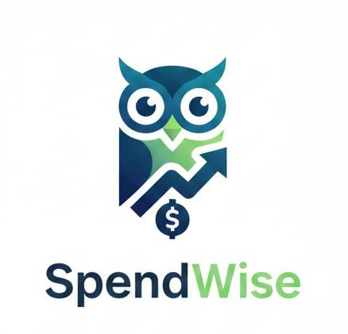

# 💰 SpendWise: Gestión Inteligente de Gastos Personales

  

SpendWise es una aplicación full-stack diseñada para ayudar a los usuarios a tomar control de sus finanzas personales. Permite registrar, clasificar y visualizar gastos e ingresos de forma segura. Además, incluye funcionalidades avanzadas de previsión de gastos y colaboración.

---

## 🚀 Arquitectura y Tecnologías

Este proyecto sigue una arquitectura **Full-Stack** moderna, separando completamente el Frontend (UI) del Backend (API).

### 🖥 Frontend (Cliente)

| Tecnología | Descripción |
| :--- | :--- |
| **Angular** | Framework de JavaScript robusto para construir la interfaz de usuario. |
| **PrimeNG** | Suite de componentes de UI y gráficos avanzada, utilizada para la visualización de datos (gráficos circulares, de barras). |
| **TypeScript** | Lenguaje principal de desarrollo para garantizar código escalable y tipado. |
| **HTTP Interceptors** | Implementado para manejar la seguridad (JWT) y la gestión de errores global. |

### ⚙️ Backend (API)

| Tecnología | Descripción |
| :--- | :--- |
| **Java** | Lenguaje de programación principal para el backend. |
| **Spring Boot** | Framework para construir una API RESTful robusta y rápida. |
| **Spring Data JPA** | Capa de persistencia para interactuar con la base de datos de manera eficiente. |
| **Spring Security (JWT)** | Solución de seguridad basada en tokens para autenticación y autorización. |
| **PostgreSQL** | Sistema de gestión de bases de datos relacionales para persistencia de datos financieros. |

---

## ✨ Funcionalidades Clave

* **Autenticación Segura (JWT):** Registro e inicio de sesión seguro, con datos privados por usuario.
* **CRUD de Transacciones:** Creación, lectura, actualización y borrado de gastos e ingresos.
* **Clasificación Flexible:** Gestión de Categorías personalizadas (Comida, Salario, Transporte).
* **Visualización de Datos:** Dashboard interactivo con gráficos generados por PrimeNG (resúmenes mensuales, distribución por categorías).
* **Plantillas de Previsión:** Creación de presupuestos recurrentes o por proyecto.
* **Colaboración (Avanzado):** Posibilidad de compartir plantillas de previsión con otros usuarios (`TemplateShare`).
* **Dashboard Personalizable:** Persistencia de la configuración de reportes y widgets del usuario (`ReportMetadata`).

---

## 🛠 Estructura del Proyecto

El proyecto se divide en dos carpetas principales que se ejecutan de forma independiente:

1.  **`/spendwise-backend`**: Contiene la aplicación Spring Boot, la lógica de negocio, los modelos JPA y los controladores REST.
2.  **`/spendwise-frontend`**: Contiene la aplicación Angular, los componentes de la interfaz de usuario, servicios de datos y el Interceptor JWT.

---

## 🚀 Guía de Instalación y Ejecución

### 1. Requisitos Previos

Asegúrate de tener instalado:
* Java Development Kit (JDK) 17 o superior.
* Node.js y pnpm.
* Angular CLI (`npm install -g @angular/cli`).
* Una instancia de PostgreSQL.

## 🛣 Metodología de Desarrollo

El proyecto se está desarrollando utilizando **Scrum** con Sprints de [X] semanas. Puedes seguir el progreso en la sección de **Issues** y **Projects** de GitHub.

### Próximos Pasos (Sprint 1 Focus)

1.  Implementación completa de la seguridad JWT en Spring Security.
2.  Creación de los componentes de Login y Registro en Angular.
3.  Desarrollo del CRUD para la entidad `Category`.

---

## 👤 Desarrollado por

Este proyecto es desarrollado por **Alberto de Pablo**.
